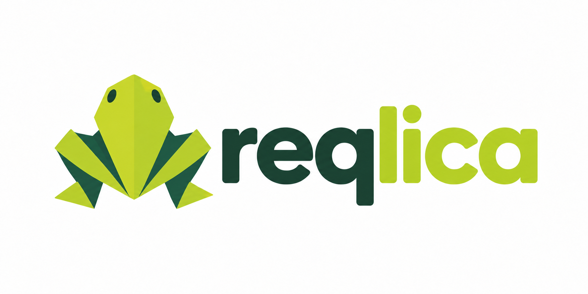

# Reqlica



A self-hosted mock backend tool for frontend developers and QA engineers.
The goal is to generate stateful Python APIs from descriptions or API specs,
then review, test, and publish them without waiting for a production backend.

## Current Status

The backend supports manually written FastAPI handlers, independent project
workers, persistent SQLite data, and a draft/test/approval/version workflow through
the CLI and management APIs. AI clients can now create and check endpoint drafts
through the console's built-in HTTP MCP server.

The standalone HTML dashboard supports resumable endpoint generation with capability-aware
output formats, local schema validation and per-file checkpoints into unpublished drafts; see the
[generation guide](docs/generation.md).
The packaged Next.js dashboard, database migrations, reset, and import/export
remain planned. See the [roadmap](docs/roadmap.md).

## Quick Start

Requires Python 3.12+, [uv](https://docs.astral.sh/uv/getting-started/installation/),
and macOS or Linux. From the repository root:

```bash
uv sync --locked
uv run reqlica start
```

Default addresses:

- Console management API: `http://127.0.0.1:3000`
- Mock gateway: `http://127.0.0.1:4000`
- MCP for AI clients (Streamable HTTP): `http://127.0.0.1:3000/mcp`
- Interactive API reference: `/docs` on either server

Override hosts, ports, or `REQLICA_HOME` in the root `.env` or environment.
Press `Ctrl+C` to stop the servers and workers; project files and data remain.

## Create a Project

In another terminal, choose a new or empty directory:

```bash
uv run reqlica project create /path/to/books --name "Book API"
uv run reqlica project list
curl http://127.0.0.1:4000/mock/<project-id>/hello
```

Creation prints the project ID and sample endpoint URL. The first request starts
its worker automatically. Manage it with:

```bash
uv run reqlica project endpoints <project-id>
uv run reqlica project stop <project-id>
uv run reqlica project start <project-id>
```

The gateway also accepts `POST /api/projects` with
`{"directory": "/absolute/path/to/books", "name": "Book API"}` and returns the
created idle project with HTTP `201`. The standalone
`backend/reqlica/reqlicav1.html` dashboard can create and delete projects; its
**Connection & help** section includes the local server launcher.

In **Request tester**, choose a route shortcut and click **Insert example** to
fill its path/query and JSON body from saved OpenAPI examples, defaults, or types.
This never sends the request and keeps custom headers. Review sample values and
record IDs before sending. Drafts need current validation; live contracts become
available after validated activation. Missing contracts leave inputs unchanged.

The same **Generate API** screen also has **Ask about project**: ask how endpoints
are designed, which inputs they accept, or how the project fits together. Groq
reads the published code, tests, notes, routes, and database definitions and returns
an explanation with source references. Follow-ups remember recent exchanges;
per-project history survives refreshes in the same tab, and **New chat** clears it.
Sources, caveats, and privacy notes are expandable rather than repeated banners.
Chat creates no drafts and runs no code;
switch explicitly to **Generate draft** to request changes. See
[`docs/generation.md`](docs/generation.md) for context/privacy details.

**Endpoints → Edit source** opens its handler in a fresh draft. **Modify with AI**
generates a targeted edit and tests without changing the published API. In
**Mock data**, describe custom records, edit/download the JSON, or validate and
explicitly append it to an existing SQLite table. Existing records are preserved;
the mock-data importer does not create tables. See [`docs/mock-data.md`](docs/mock-data.md).

Generated APIs can now include a declarative `database/schema.json` plan. In
**Drafts & checks → Database setup**, review the SQL, validate/test on disposable
copies, then confirm creating new live tables with a pre-change backup. Existing
tables/records are preserved; code approval and activation remain separate.
See [`docs/database-setup.md`](docs/database-setup.md). Destructive/alter-table
migrations are not supported.

For code expecting `JWT_SECRET` or another application variable, open
**Settings → Project environment**. Save a value or generate a secure JWT key,
rerun draft checks, and explicitly restart the published API. Values are stored
privately per project, never shown by settings APIs or sent to AI. See
[`docs/environment.md`](docs/environment.md) for security boundaries and limits.

API generation and AI endpoint edits now begin with a clarification review.
Answer questions about fields, configuration names, and behavior, then explicitly
generate from those decisions. Optional follow-up reviews preserve earlier answers.
Actual secret values belong in Project environment—not clarification answers.

Generation also checks handler/test imports before saving drafts. Clarification
uses the same declared-runtime dependency policy; missing libraries produce
actionable errors rather than automatic installs. See
[dependency handling](docs/generation.md#dependencies-and-missing-package-errors).

Failed draft checks now offer **Repair with AI…**: Reqlica uses the original spec,
current implementation/tests and failure logs to repair implementation and rerun
checks for at most two confirmed attempts. Tests, routes and schema plans remain
protected; code backups are kept. It never installs packages or publishes code.
See [draft recovery](docs/generation.md#repair-a-failed-draft).

Remove a project through the running gateway (confirmation required):

```bash
uv run reqlica project delete "Book API"                # Unregister; keep files/data
uv run reqlica project delete <project-id> --delete-files # Also erase the project folder
```

Names and unique ID prefixes of six or more characters work. Add `--yes` to
confirm non-interactively. Deletion stops the worker and clears registry/runtime
state without restarting Reqlica; `project stop` alone does not remove a project.

## Change an API

Create a draft rather than editing published versions:

```bash
uv run reqlica draft create <project-id> --json
uv run reqlica draft inspect <project-id> <draft-id>
```

For human checks, use a project name or unique ID prefix and a draft ID prefix
(six or more characters), without copying a revision hash:

```bash
uv run reqlica draft validate "Book API" <draft-prefix>
uv run reqlica draft test "Book API" <draft-prefix>
uv run reqlica draft url "Book API" <draft-prefix> /hello
```

The URL previews current draft code using disposable data. `draft call` also
resolves the revision automatically; explicit `--revision` is still supported.

Validation also saves revision-linked OpenAPI. Ask MCP's `get_api_schema` for
request/response formats, or `get_draft_urls` for Swagger and JSON links. See the
[API schema guide](docs/api-schemas.md); unknown/free-form contracts produce warnings
rather than guessed payloads.

Edit draft files/routes, validate and test the exact revision, then explicitly
approve and activate it. Draft checks use disposable database copies and do not
change live records through the SDK. See the [draft and version guide](docs/persistence-drafts-versions.md)
for commands, examples, legacy conversion, and recovery.

## Development

Run backend tests:

```bash
uv run python -m unittest discover -s tests
```
y
- [Development guide](docs/development.md): configuration, troubleshooting, project APIs, and code layout.
- [Drafts and versions](docs/persistence-drafts-versions.md): editing, checks, approval, persistence, and activation.
- [MCP tools](docs/mcp.md): connect an AI client and generate endpoint drafts.
- [API schemas](docs/api-schemas.md): generated contracts and draft/published Swagger docs.
- [Roadmap and design](docs/roadmap.md): planned features, MCP tools, and development order.

**Local trusted use only:** management APIs are unauthenticated. Keep servers on
loopback and only load trusted Python; separate workers are not a security sandbox.
