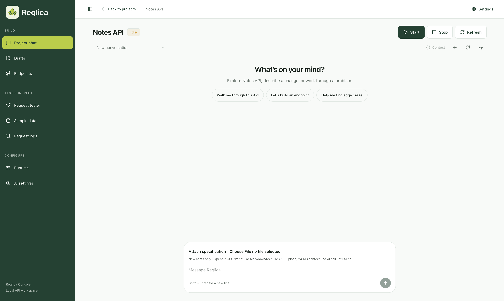

# Reqlica


Reqlica creates stateful mock APIs from a description or OpenAPI specification.
You review the generated Python, run checks, then approve and publish it.
Endpoints run with FastAPI and SQLite; serving requests does not call an AI model.

Use Reqlica through either:

- **The web interface:** create projects, chat with Project AI, review drafts,
  and test requests in the browser.
- **An agent of your choice:** connect any MCP-capable agent, such as OpenCode,
  to Reqlica's MCP server. The agent uses its own model and credentials.



## Features

- **AI API generation:** turn a description or OpenAPI specification into Python
  endpoints, route definitions, and tests.
- **Persistent data:** keep SQLite records across requests, worker restarts,
  and code updates.
- **Review before publishing:** edit drafts, run validation and behavior tests,
  then approve and activate the checked version.
- **Sample data:** generate and validate JSON fixtures or related database
  records before confirming insertion.
- **Request testing:** try endpoints with the built-in tester, chain requests,
  and inspect OpenAPI contracts in Swagger.
- **Traffic controls:** configure delays, failures, rate limits, mock credentials,
  and browser access through CORS.
- **Logs and recovery:** inspect requests and errors, restore data baselines,
  and back up or transfer projects.
- **Runtime management:** start and stop APIs, configure environment variables,
  review package installs, and apply database changes.

## Documentation

- [Installation](docs/guides/installation.md)
- [Architecture](docs/architecture.md)
- [Technology](docs/technology.md)
- [Limitations](docs/limitations.md) and [future work](docs/roadmap.md)
- [AI usage disclosure](docs/ai-usage.md)
- [Other guides](docs/guides/README.md)

## Quick start

Requires macOS or Linux, Python 3.12+, and uv. The built dashboard is included.
Run from the repository root:

```bash
uv sync --locked
cp .env.example .env
uv run reqlica start
```

Open the dashboard at http://127.0.0.1:3000. Mock requests use port `4000`.
MCP clients connect to `http://127.0.0.1:3000/mcp` using Streamable HTTP.
[.env.example](.env.example) documents the defaults. Edit `.env` to change ports
or the app-state directory. See [installation](docs/guides/installation.md)
for the full setup.

## AI use

Use a model that supports tool calls. Project AI supports Groq, OpenAI,
OpenAI-compatible APIs, and Ollama. Reqlica exposes MCP tools so other agents, including OpenCode, can use them
with a tool-capable model and their own provider connection.

AI output becomes draft files, routes, and validated records. `step_run()` and
`_execute_tool()` in [agent.py](backend/reqlica/generation/agent.py) consume the
model's tool calls. See the [disclosure](docs/ai-usage.md) for details.

## Development

See [development](docs/guides/development.md) for frontend builds, server integration,
and checks. Users can run the included dashboard without rebuilding it.

Reqlica is for trusted local use. Management APIs are unauthenticated, and
workers run Python with your OS permissions. Keep both servers on loopback.
