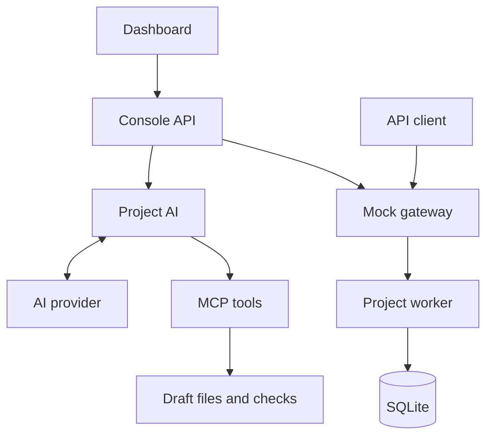

# Architecture

Reqlica has two paths: authoring an API and serving its published code.
AI is used during authoring. Published requests run Python against SQLite.



## Components

| Component  | Source                              | Role                                                |
| ---------- | ----------------------------------- | --------------------------------------------------- |
| Dashboard  | `frontend/src/`                     | Chat, draft review, data, and request testing.      |
| Console    | `backend/reqlica/console/`          | Serves the dashboard, management API, and MCP.      |
| Project AI | `backend/reqlica/generation/`       | Sends context to a model and processes tool calls.  |
| MCP tools  | `backend/reqlica/mcp/`              | Read context, edit drafts, and run checks.          |
| Gateway    | `backend/reqlica/runtime/app.py`    | Applies access/traffic rules and forwards requests. |
| Worker     | `backend/reqlica/runtime/worker.py` | Loads one project's published FastAPI handlers.     |
| Storage    | `backend/reqlica/projects/`         | Manages files, revisions, settings, and data.       |

The Next.js dashboard is exported as static files, committed under
`backend/reqlica/static/`, and bundled with Python.
There is no Node.js server at runtime. Dashboard requests use `/api/ui/` adapters.

## Authoring

1. A user submits requirements or a specification.
2. The model produces tool calls that write source, tests, and route definitions.
3. Validation and tests run on disposable code and database copies.
4. The user reviews and approves the checked revision, then activates it.
5. Activation snapshots code, backs up data, and verifies worker startup.

Edits invalidate checks and approval. Database changes have a separate review
step. Built-in Project AI cannot approve, publish, set secrets, or insert live data.
The [AI disclosure](ai-usage.md) names the functions that process model output.

## Requests and storage

`/mock/<project-id>/<path>` goes through gateway access and traffic rules to the
project worker. An idle worker starts on demand; a stopped worker needs an
explicit start. SQLite data survives restarts and publication. Restoring code
does not restore old data.

```text
<project>/
  project.json    Identity and active version
  data.sqlite     Live data
  versions/       Published code
  drafts/         Editable code
  .reqlica/       Checks, conversations, settings, and recovery files
```

`$REQLICA_HOME/projects/` stores registry entries. `REQLICA_HOME` defaults to
`~/.reqlica`; app-wide provider keys live under its `provider-keys/` directory.

Workers are local processes, not security sandboxes. See
[limitations](limitations.md) before running generated code.

[Documentation](README.md)
