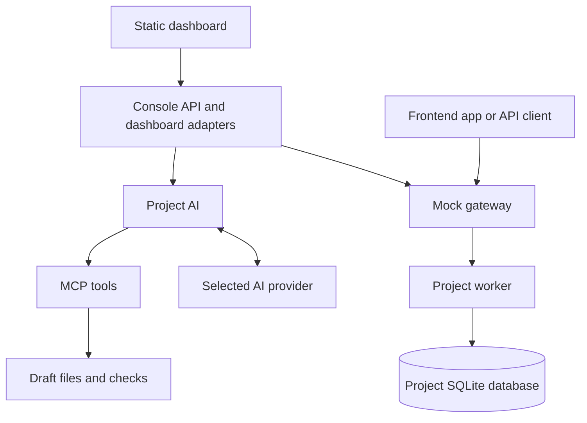

# Architecture

Reqlica is a local platform for creating and running stateful mock APIs. It
separates API authoring from request execution: AI-assisted changes are made in
drafts, while project workers serve published Python code backed by SQLite.

## System components

The console serves the built dashboard and its API adapters. Only mock traffic
and runtime operations are forwarded to the gateway.



| Component       | Responsibility                                                                                                                               | Source                              |
| --------------- | -------------------------------------------------------------------------------------------------------------------------------------------- | ----------------------------------- |
| Dashboard       | Static pages for project chat, draft editing, checks, publishing, and request testing. Served by the console.                                | `frontend/src/`                     |
| Console API     | Serves dashboard assets and `/api/ui/` adapters. Manages drafts, checks, AI conversations, settings, and project data. Hosts MCP at `/mcp`.  | `backend/reqlica/console/`          |
| Project AI      | Sends context to the selected model and handles its tool calls. Saves conversation progress after each step.                                 | `backend/reqlica/generation/`       |
| MCP tools       | Read project context, edit drafts, run checks, and prepare data previews. External AI clients can also connect here.                         | `backend/reqlica/mcp/`              |
| Mock gateway    | Receives mock requests, applies traffic and access rules, and forwards requests to the right worker. Manages worker startup and publication. | `backend/reqlica/runtime/app.py`    |
| Project worker  | Loads the published route manifest and Python handlers in a separate process for each project.                                               | `backend/reqlica/runtime/worker.py` |
| Project storage | Tracks project locations, drafts, published versions, and saved state on disk.                                                               | `backend/reqlica/projects/`         |

See [Technology details](technology.md) for the implementation stack.

## Authoring and publication

1. The user sends a description or specification through project chat.
2. Project AI reads context and asks the selected model for an answer or tool calls.
3. Allowed tool calls write source, tests, and route definitions into a draft.
   Check failures return to the model so it can repair the draft.
4. Validation and tests run against disposable copies of code and data. Results
   are tied to the exact draft revision. Editing the draft invalidates previous
   checks and approval.
5. The user approves that revision, then activates it in a separate action.
   Passing tests must exercise changed handlers. Required database changes have
   their own review and apply steps.
6. Activation creates a code snapshot, drains active requests, backs up the
   database, and checks candidate startup before updating the active version.
   Requests can be briefly unavailable during activation.

AI edits and code execution have separate permissions. The server checks project
scope, draft revision, and conversation budgets before running tools. Project AI
cannot approve or publish code, set secrets, or insert live data.

## AI output processing

In `backend/reqlica/generation/agent.py`, `step_run()` reads the model's
`tool_calls` and saves them as pending actions. `_execute_tool()` checks their
arguments and calls the MCP tool through `session.call_tool()`.

For example, `write_draft_file()` in `backend/reqlica/mcp/server.py` saves
model-produced Python into the draft. After checks and human publication,
`build_app()` in `backend/reqlica/runtime/worker.py` loads the published handlers
and registers their routes with FastAPI.

Model output is consumed as structured tool calls and draft source code.
`preview_mock_data()` in `backend/reqlica/mcp/data.py` also parses generated JSON
and validates record batches against supported contracts and disposable data. A
passed preview ends the turn for human review. Once published, generated handlers
execute without model calls. See the [AI usage disclosure](ai-usage.md) for exact
consumption points and development assistance.

## Request lifecycle

A client calls `/mock/<project-id>/<path>` on the gateway. The gateway checks
configured authentication, CORS, and traffic rules, then forwards the request to
the project's worker. An idle worker starts on demand; an explicitly stopped
worker requires a manual start.

The worker runs the matching Python handler. Handlers can use Reqlica's database
SDK to read and write the project's SQLite data. Records survive requests,
worker restarts, and code publication. Restoring an older code version does not
restore older data.

## Data and persistence

```text
<project>/
  project.json       Project identity and active version
  data.sqlite        Live API data
  versions/          Published code snapshots
  drafts/            Editable code and saved check results
  .reqlica/          Conversations, private settings, and recovery state
```

The registry in `$REQLICA_HOME/projects/` points to project directories.
`REQLICA_HOME` defaults to `~/.reqlica`. Provider keys are stored separately under
`$REQLICA_HOME/provider-keys/`, outside project source and saved conversations.
Conversation requests send project context to the selected provider. Saved
conversations remain on disk and can be resumed after a server restart.

## Deployment and trust boundaries

Reqlica supports trusted local use on macOS and Linux. Management APIs are
unauthenticated and should remain bound to loopback. Separate worker processes
provide process isolation, not a security sandbox: handlers and checks have the
local user's filesystem and network permissions. Python dependencies are shared
across projects.

### Packaged deployment

The frontend is exported as HTML, JavaScript, and CSS. The build script copies
these assets into `backend/reqlica/static/`, and package builds include them in
the wheel and source archive. The console serves the dashboard at `/`, alongside
its management API and MCP endpoint. `reqlica start` launches the console and
mock gateway; no Node.js server is required.

Dashboard requests use same-origin `/api/ui/` adapters. Console operations are
dispatched in process to existing management routes. Runtime operations are
forwarded to the configured gateway. The adapters retain origin checks, explicit
confirmations, revision checks, and bounded request previews.

Project pages use `/project?projectId=<id>` so projects created after the frontend
build remain accessible. Legacy `/projects/<id>` links redirect to that page.

### Development setup

Node.js 20.9+ and npm are required to build the dashboard. Run
`python3 scripts/build_frontend.py` after installing frontend dependencies, then
start Reqlica. Rebuild after frontend changes. Default ports are `3000` for the
console and dashboard, and `4000` for the gateway.

See [drafts and versions](guides/persistence-drafts-versions.md),
[Project AI](guides/generation.md), and [database maintenance](guides/maintenance.md) for the
full workflows. Current constraints are collected in [limitations](limitations.md),
and possible extensions in the [roadmap](roadmap.md).

[Documentation index](README.md) · [Project overview](../README.md)
